# 🐣 S1 | # Rapport de Workshop

Template de projet pour le workshop de prog des Imac1. Vous trouverez le sujet ici: https://dsmte.github.io/Learn--cpp_programming/Workshop

**image de départ**

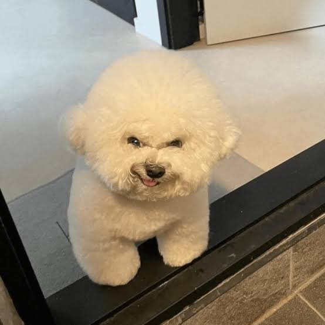

## ⭐ Ne garder que le vert

## ⭐ Échanger les canaux

**échange le rouge et le rouge, puis le vert et le rouge, puis bleu vert et enfin rouge bleu**

**Cette fonction m'a donné un peu de fil à retordre car j'ai du utilisé plusieurs fonction qui modifier des pixel mais avait oublié que les images était des copies et non des références**

## ⭐ Noir & Blanc

## ⭐ Négatif

## ⭐ Dégradé

## Degrad d'image

**prend une image et fait un fondu blanc vert la droite**

## ⭐⭐ Miroir

## ⭐⭐ Image bruitée

## ⭐⭐ Rotation de 90°

## ⭐⭐ RGB split

## ⭐⭐ Luminosité

## ⭐⭐(⭐) Disque

## ⭐⭐ Cercle

## ⭐⭐ Animation

## ⭐⭐⭐ Rosace

## rosace Croissant

## ⭐⭐ Mosaïque

## ⭐⭐⭐⭐ Mosaïque miroir

## mosaique mixed

**lors de la création de mosaique mirroir, par erreur au lieu de faire mirroir à chaque itération de l'image, je l'avais fait sur chaque pixel, obtenant ansi ce résultat**

## ⭐⭐⭐(⭐) Fractale de Mandelbrot

**après avoir réussit à obtenir une fractale réussit j'ai décidé d'essayer d'augmenter la puisance de la formule z = z x z + c en z = z x z x z +x, voici le résultat de la puissance 0 à la puissance 19**

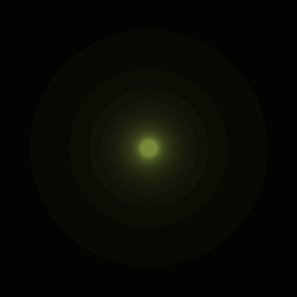

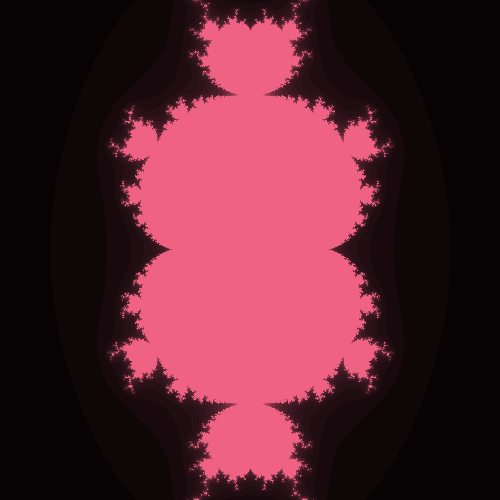
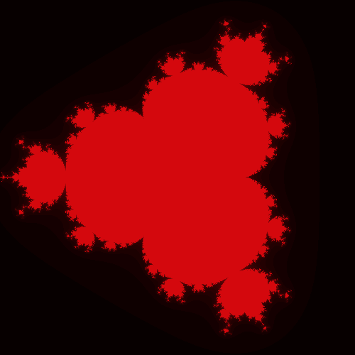
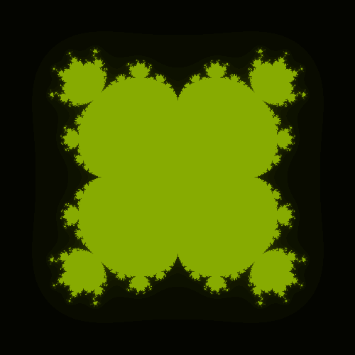
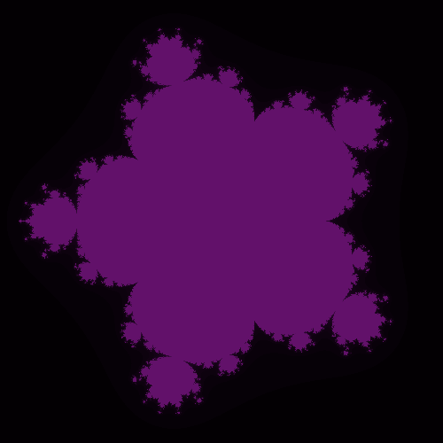
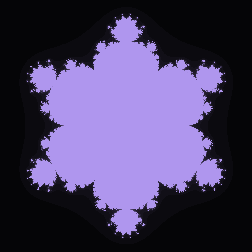
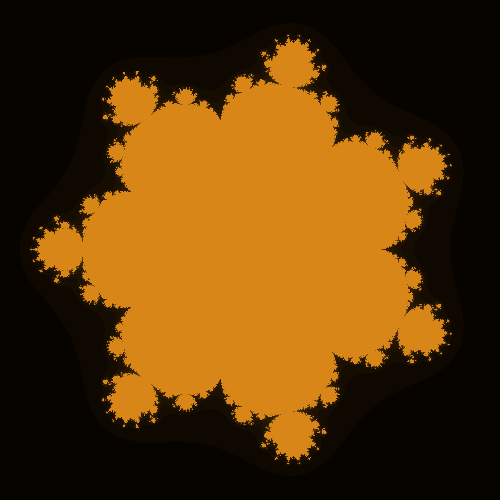

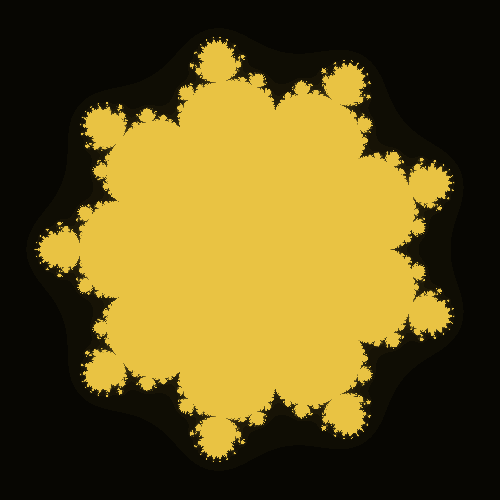
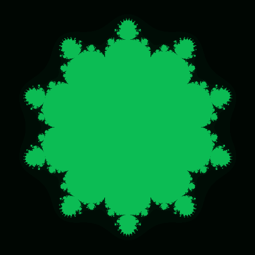
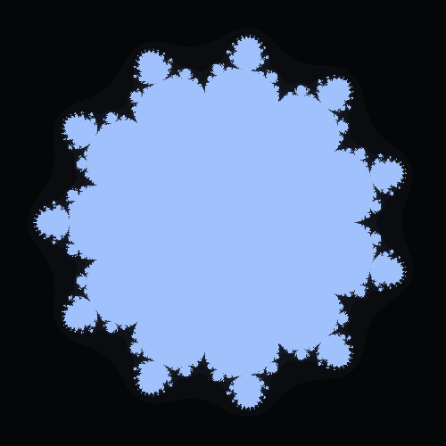

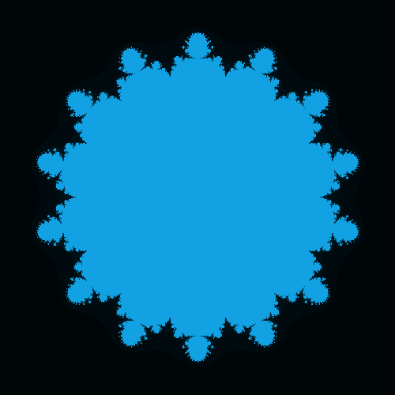

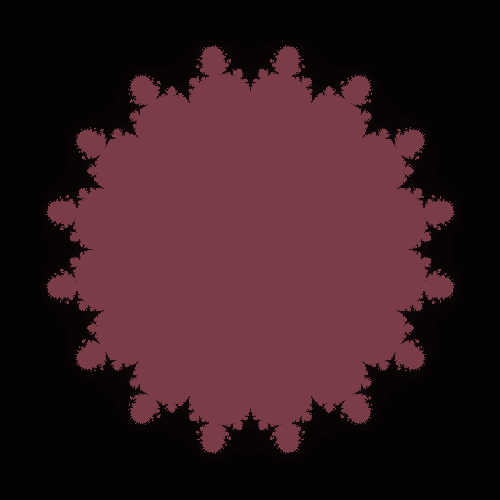
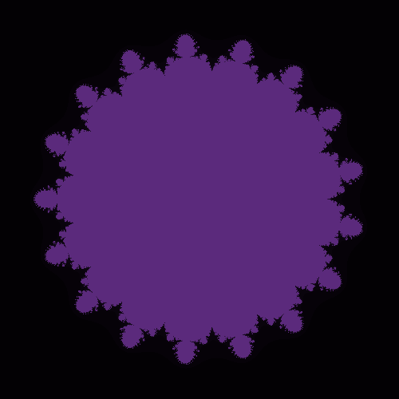

**en modifiant de sorte à ne pas commencé par z = 0 +0i mais par 1+ 0i, ensuite 0+ i et finalement 1+i on obtient ces résultat là, on remarque qu'un coté de la fractale augmente trop vite éxplicant l'absence de pointes dans les images suivantes**

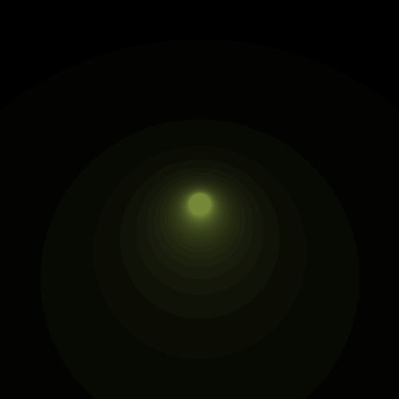
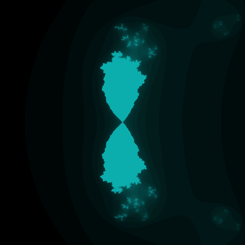
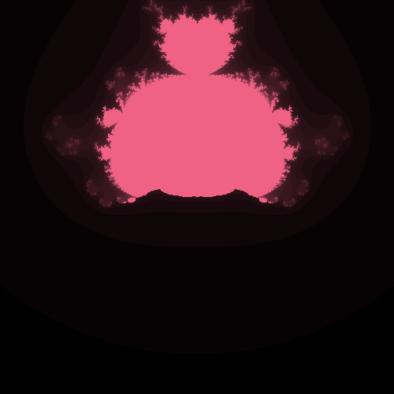

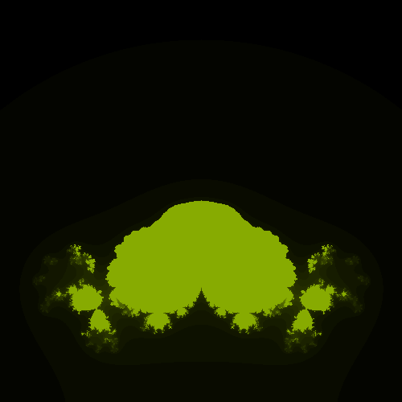

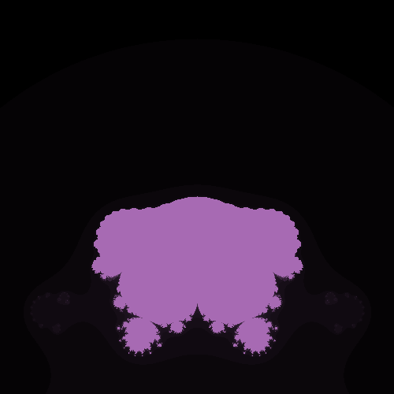

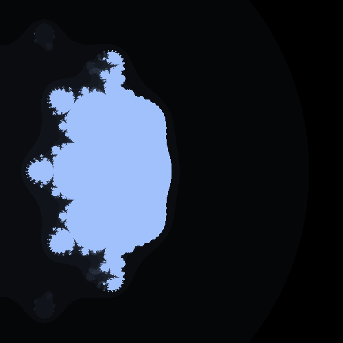
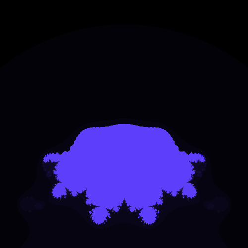

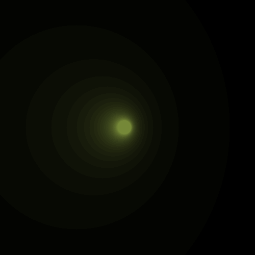
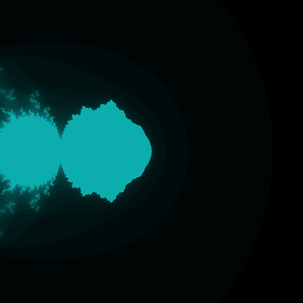

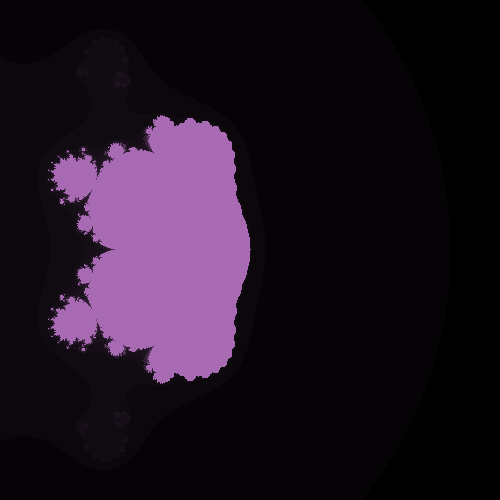
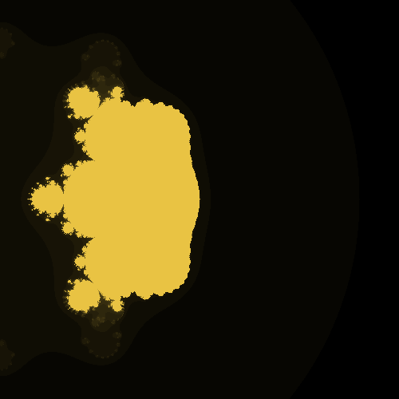

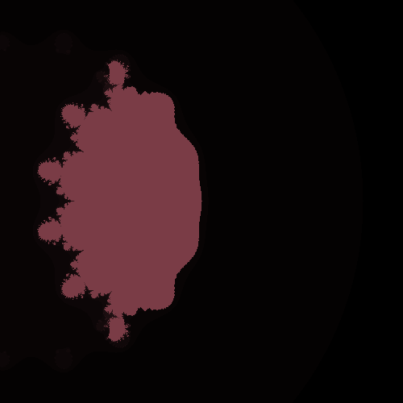
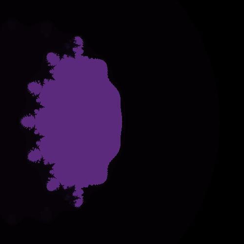
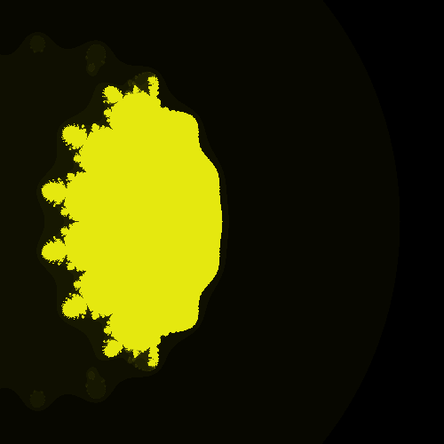


## ⭐⭐⭐(⭐) Dégradés dans l'espace de couleur Lab

## ⭐⭐⭐(⭐) Tramage
**le tramge m'a donné bcp de fil à retordre, devoir lire 2 document certes intéressant mais pas forcémeent claire m'a pris pas mal de temps. De plus std::pow semble marcher à première vue, mais ne gère pas les nombres négatif, cette exercice fut tout de même très satisfaisant à accomplir**

**Noir et blanc**

**Noir et blanc avec aléatoire plus ou moins fort**

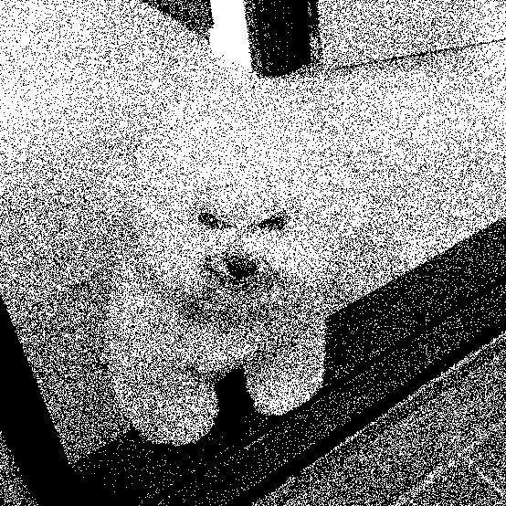

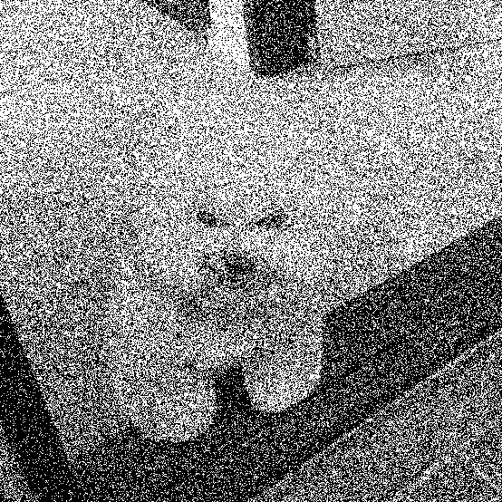

**Noir et blanc avec matrice 2*2*

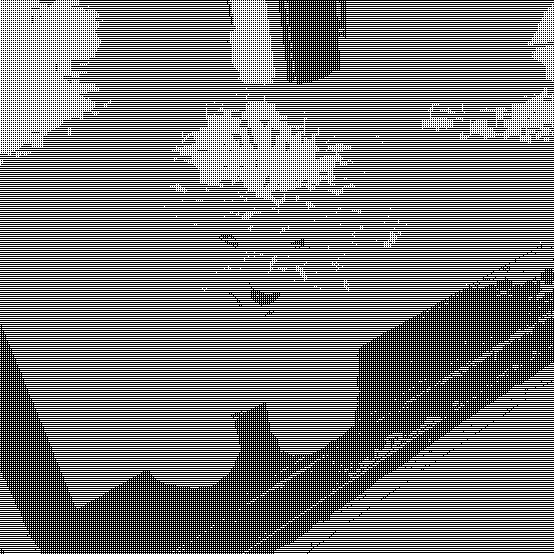

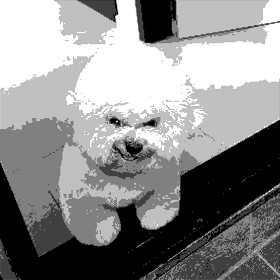
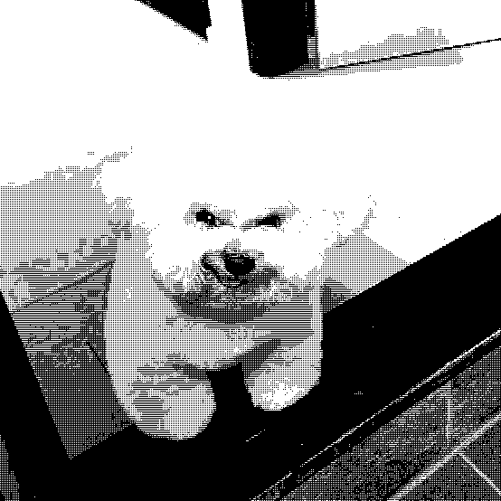

**Noir et blanc avec matrice 4*4*

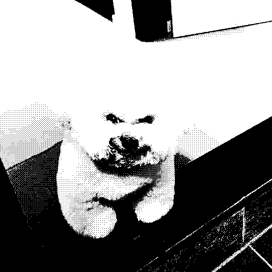

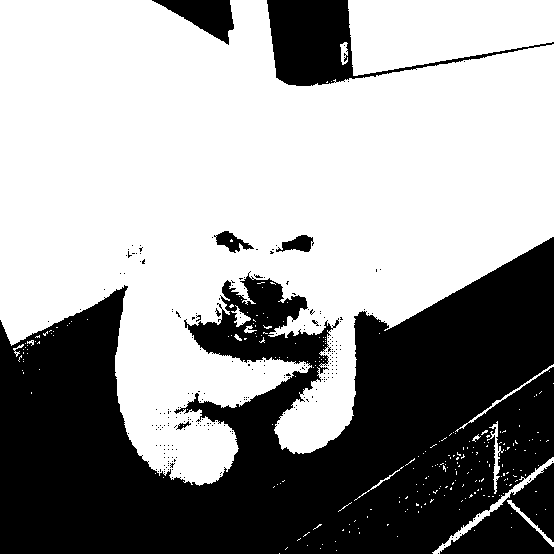

## ⭐⭐⭐(⭐) Normalisation de l'histogramme
**la nomalisation semble fonctionner mais je pense qu'il y a un problème avec les images monochrome, ou les courtes fréquences de couleurs**

## ⭐⭐⭐⭐ Vortex
**j'ai eu pas mal de difficulté a comprendre comment avoir un vortex sans trou, cependant ça m'a permit d'obtenir ces résultats hypnotiques fort sympatique**

## ⭐⭐⭐⭐⭐⭐ Diamond Square
**j'ai adoré cette exercice, un algo fascinant qui permet d'obtenir des résultats utiles, j'ai donc fait plusieurs version dont certaine très aléatoire comme la dernière ci-dessous**

## ⭐⭐ Colorer la height map

** j'espère que ce rapport vous a plu, les fonctions sont toutes mises en commentaires si vous avez un doute sur leur fonctionnement **

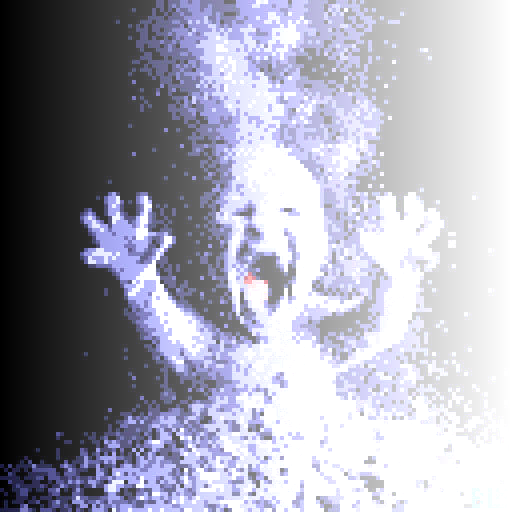