# 🐣 S1 | # Rapport de Workshop

Template de projet pour le workshop de prog des Imac1. Vous trouverez le sujet ici: https://dsmte.github.io/Learn--cpp_programming/Workshop

**image de départ**

## ⭐ Ne garder que le vert

## ⭐ Échanger les canaux

**échange le rouge et le rouge, puis le vert et le rouge, puis bleu vert et enfin rouge bleu**

**Cette fonction m'a donné un peu de fil à retordre car j'ai du utilisé plusieurs fonction qui modifier des pixel mais avait oublié que les images était des copies et non des références**

## ⭐ Noir & Blanc

## ⭐ Négatif

## ⭐ Dégradé

## Degrad d'image

**prend une image et fait un fondu blanc vert la droite**

## ⭐⭐ Miroir

## ⭐⭐ Image bruitée

## ⭐⭐ Rotation de 90°

## ⭐⭐ RGB split

## ⭐⭐ Luminosité

## ⭐⭐(⭐) Disque

## ⭐⭐ Cercle

## ⭐⭐ Animation

## ⭐⭐⭐ Rosace

## rosace Croissant

## ⭐⭐ Mosaïque

## ⭐⭐⭐⭐ Mosaïque miroir

## mosaique mixed

**lors de la création de mosaique mirroir, par erreur au lieu de faire mirroir à chaque itération de l'image, je l'avais fait sur chaque pixel, obtenant ansi ce résultat**

## ⭐⭐⭐(⭐) Fractale de Mandelbrot

**après avoir réussit à obtenir une fractale réussit j'ai décidé d'essayer d'augmenter la puisance de la formule z = z x z + c en z = z x z x z +x, voici le résultat de la puissance 0 à la puissance 19**

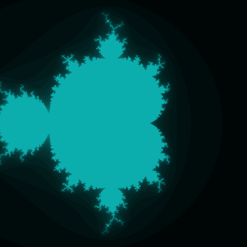

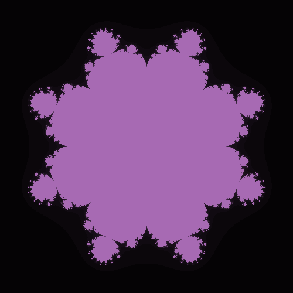

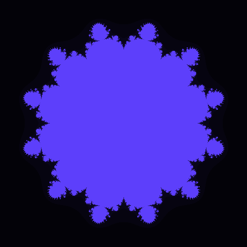
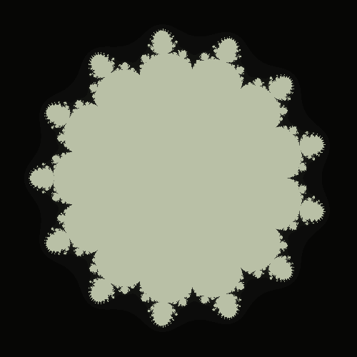

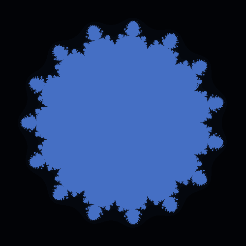

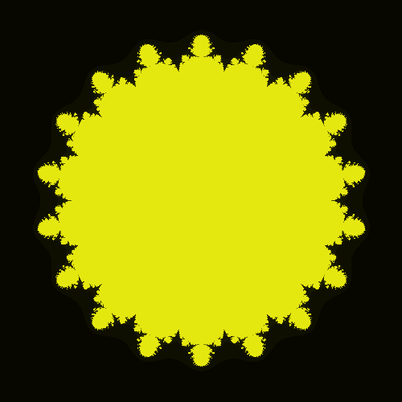

**en modifiant de sorte à ne pas commencé par z = 0 +0i mais par 1+ 0i, ensuite 0+ i et finalement 1+i on obtient ces résultat là, on remarque qu'un coté de la fractale augmente trop vite éxplicant l'absence de pointes dans les images suivantes**

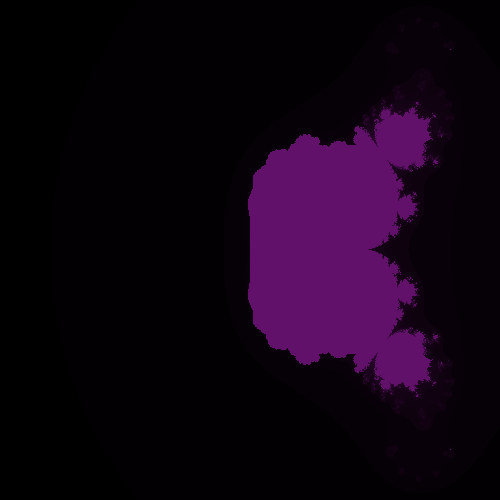
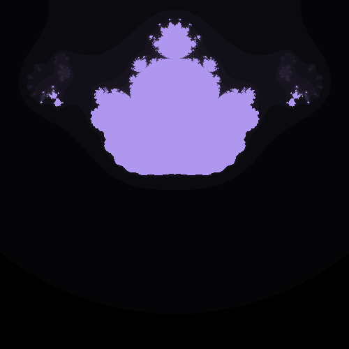

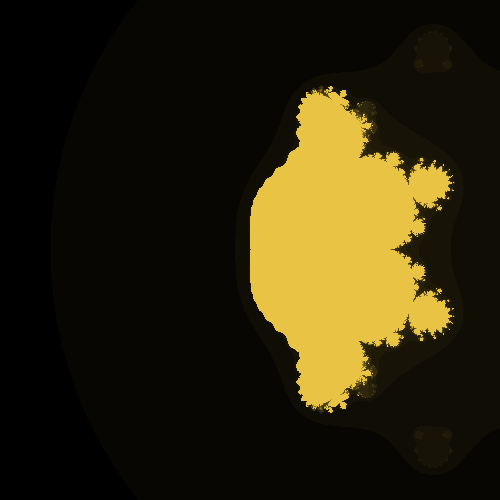

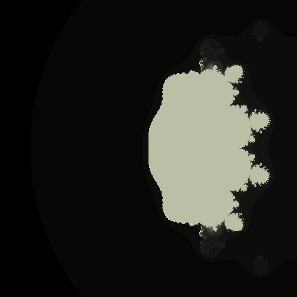

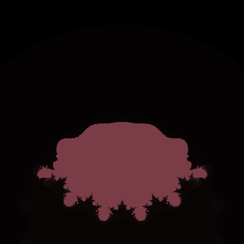
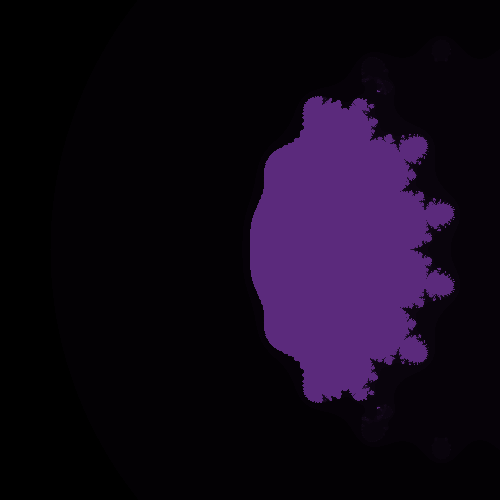
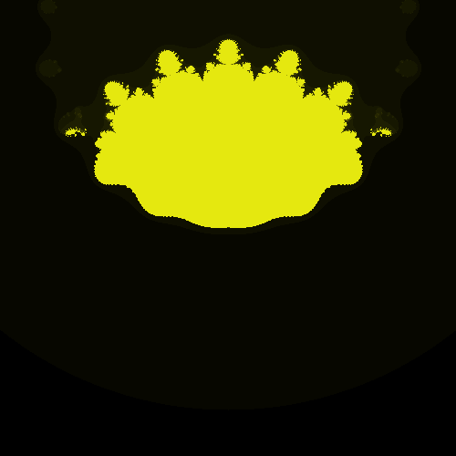

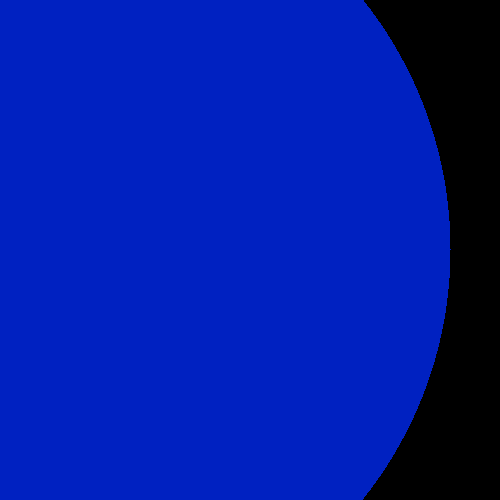

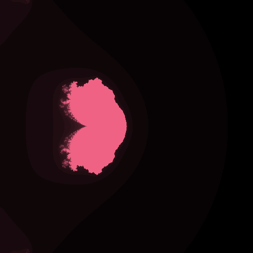
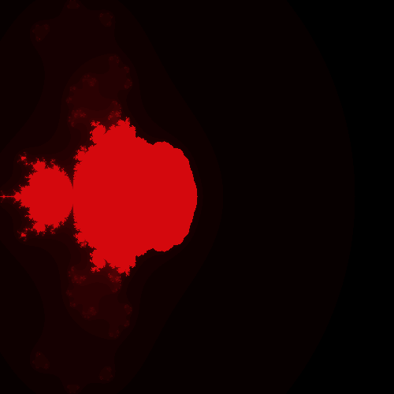
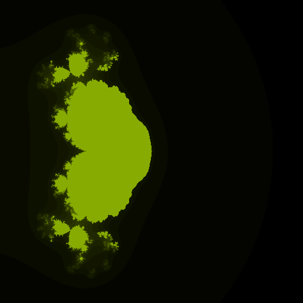
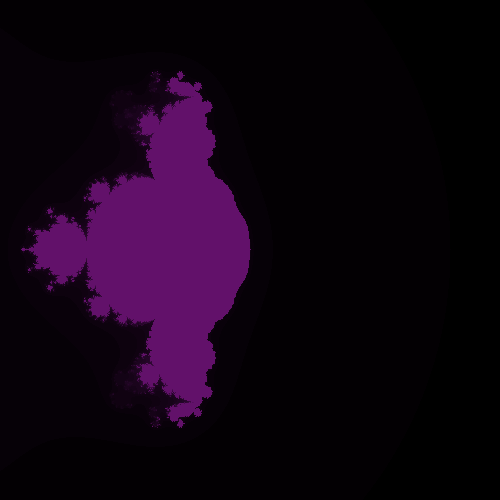
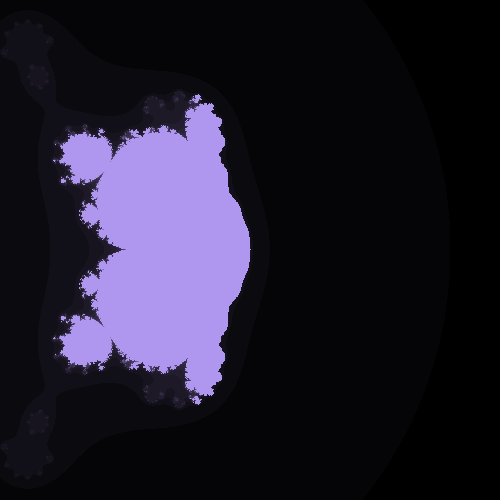
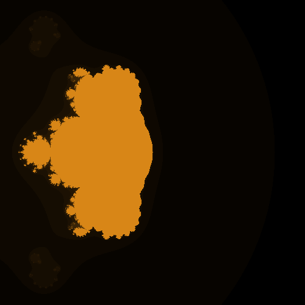

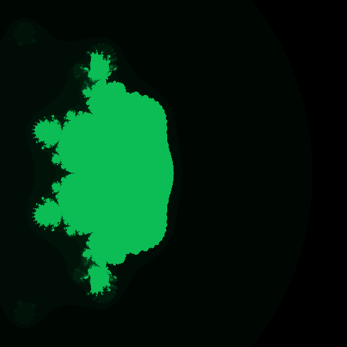

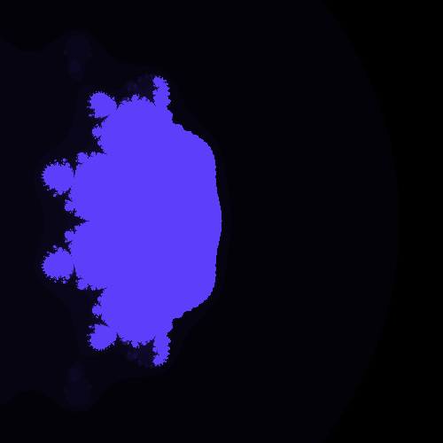
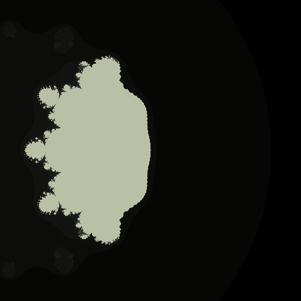
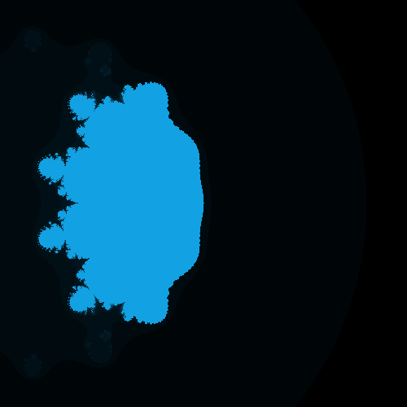

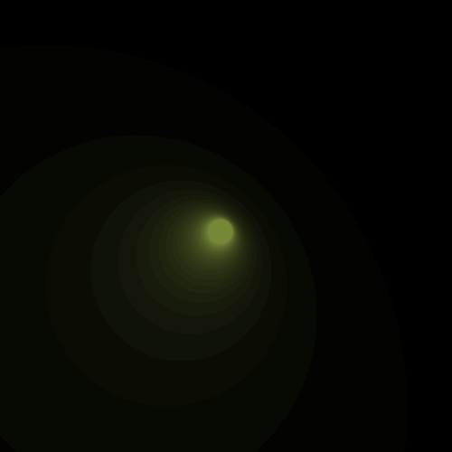
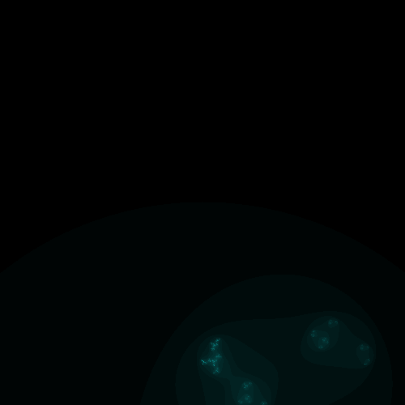

## fractale Special

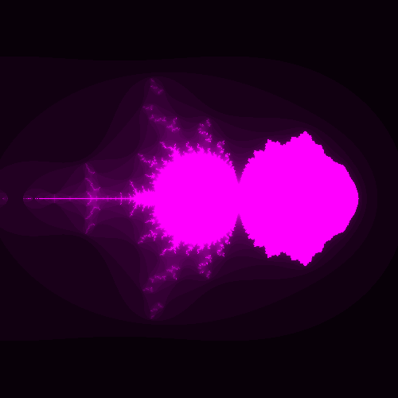

## ⭐⭐⭐(⭐) Dégradés dans l'espace de couleur Lab

## ⭐⭐⭐(⭐) Tramage

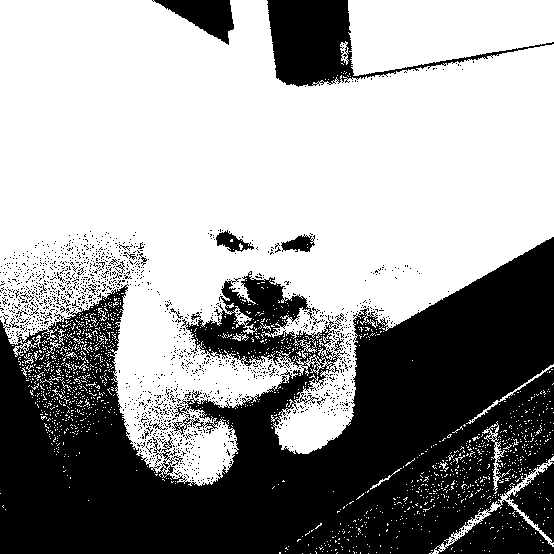

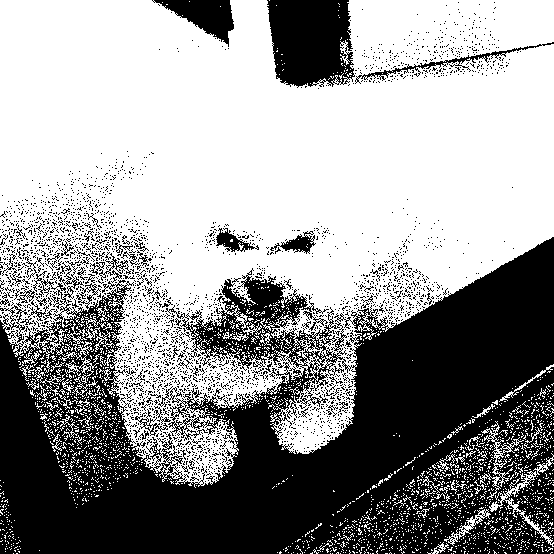
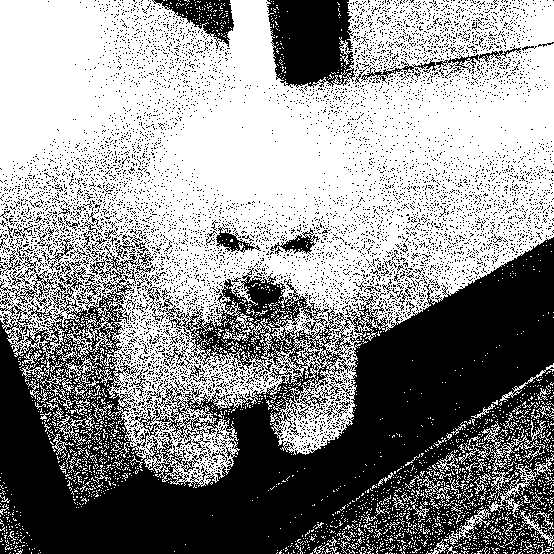

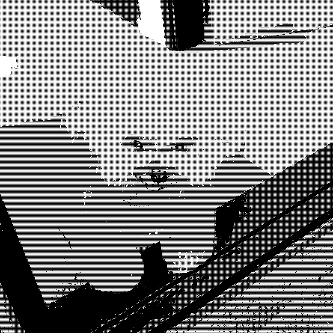

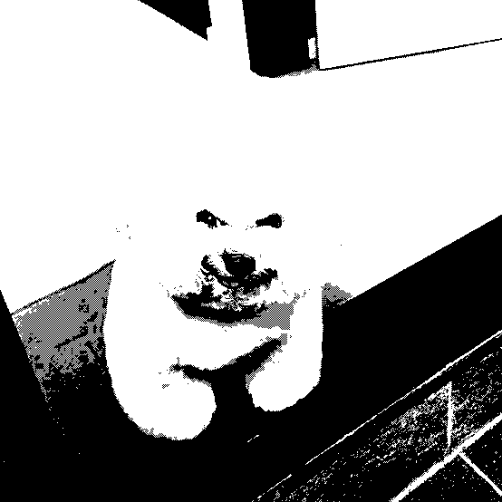

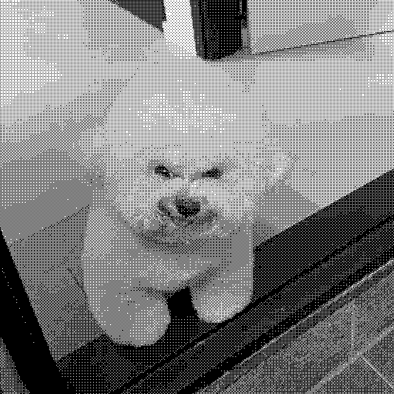
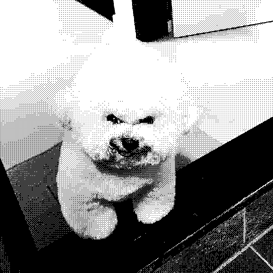

## ⭐⭐⭐(⭐) Normalisation de l'histogramme

## ⭐⭐⭐⭐ Vortex

## ⭐⭐⭐⭐⭐⭐ Diamond Square

## ⭐⭐ Colorer la height map

**a)**

**let x = 1 in let x = 2 in x**

**2**

**let x = 1; y = x in let x = 3 in x + y**

**4**

**let x = 1; y = x; z = x + y in let x = 3; y = 2*x in (x, y, z)**

**(3,6,2)**

**let x = y + 1; y = x + 2 in (x, y)**

**( boucle infini**

**let x = x*x in x**

**boucle infini**

**let x = x*x in let x = 1 in x**

**1**

**let x = 1 in let x = x*x in x**

**boucle infini**

**(b) Considérons un cylindre de hauteur h et un rayon r. Calculez l’aire d du disque qui forme la base du cylindre (c.-à-d. πr2) en une seule expression et en utilisant une liaison locale pour r.**

**let r = 1 in r * r * pi**

**(c) Écrire une expression permettant de calculer le triplet (p, s, v) où p est le périmètre de la base(c.-à-d. 2πr), s est la surface totale (c.-à-d. 2d + ph), et v son volume(c’est-à-dire dh). Bien entendu, les expressions apparaissant dans plusieurs calculs différents ne doivent être calculéesqu’une seule fois**

**let r = 1; h = 1; p = 2 * pi * r; d = r * r * pi in (p, 2 * d + p * h, d * h)**

## Exercice 3:

**(a) Calculer le maximum entre les entiers x et y (dans une liaison locale).**

**let x = 1; y = 2 in if x > y then x else y**

**(b) Calculer le maximum entre les entiers x, y et z (dans une liaison locale).**

**let x = 9; y = 15; z = 3 in if x > y && x > z then x else if y > x && y > z then y else z**

**(c) Étant donné un entier x, en utilisant une expression conditionnelle, donnez le code permettant d’obtenir ⌈x/2⌉. Rappelons que ⌈. . . ⌉ est la fonction « partie entière supérieure ».**

**let x = 3 in if odd x then div x 2 + 1 else div x 2**

**(d) Étant donnés trois entiers x, y et z, calculer l’expression**

**let x = 1; y = 1; z = 1 in (if (x > y) then x else y)^2 + if z `mod` 3 == 0 then 1 else 0**

## Exercice4:

**(a) Écrire la fonction myAverage :: Float -> Float -> Float -> Float qui calcule la moyenne de 3 réels.**

**myAverage :: Float -> Float -> Float -> Float**
**myAverage x y z = (x + y + z)/3**

**(b) Écrire la fonction myMin2 :: Int -> Int -> Int qui calcule le minimum de deux entiers. Écrire ensuite la fonction myMin3 :: Int -> Int -> Int -> Int qui calcule le minimum de trois entiers.**

**myMin2 :: Int -> Int -> Int**
**myMin2 x y = if x < y then x else y**

**myMin3 :: Int -> Int -> Int -> Int**
**myMin3 x y z = if x < y && x < z then x else if y < x && y < z then y else z**

**(c) Sans utiliser les opérateurs + et/ou −, écrire la fonction myAdd :: Int -> Int -> Int qui calcule 1 la somme x + y. Nous supposerons dans cet exercice que y ⩾ 0.**

**myAdd :: Int -> Int -> Int**
**myAdd x y = if y > 0 then myAdd (succ x) (pred y) else x**

**(d) Sans utiliser les opérateurs + et −, ni ×, écrire la fonction myMult :: Int -> Int -> Int qui calcule 2 le produit x × y. Nous supposerons dans cet exercice que y ⩾ 0.**

**myMult :: Int -> Int -> Int**
**myMult x y = if y > 0 then myAdd (myMult x (pred y)) x else 0**

**(e) Écrire la fonction myFact :: Int -> Int qui calcule la factorielle n!. Nous supposerons dans cet exercice que n ⩾ 0.**

**myFact :: Int -> Int**
**myFact x = if x > 1 then myMult (myFact (pred x)) x else 1**

**(f) Écrire une nouvelle version de la fonction myFact pour résoudre ce problème.**

    **!**

**(g) Écrire la fonction myGCDEuclid :: Int -> Int -> Int qui calcule le Plus Grand Commun Diviseur de x et y en utilisant l’algorithme d’Euclide : Étant donnés deux entiers x et y positifs**

**myGCDEuclid :: Int -> Int -> Int**
**myGCDEuclid x y = if x == y then x else (if x > y then myGCDEuclid (x-y) y else myGCDEuclid (y-x) x)**

**(h) Écrire la fonction myGCDEuclidean :: Int -> Int -> Int**

**myReste :: Int -> Int -> Int**
**myReste x y = if (x - y) > 0 then myReste (x-y) y else x**

**myGCDEuclidean :: Int -> Int -> Int**
**myGCDEuclidean x y = if x == 0 then y else (if y == 0 then x else (if x > y then myGCDEuclid y (myReste x y) else myGCDEuclid x (myReste y x)))**

**(i) Écrire la fonction (attention au typage) myAverage2 :: Int -> Int -> Int -> Float qui calcule la moyenne de 3 entiers.**

**!**

**(j) Écrire la fonction (attention au typage) detectZero :: (Int -> Int) -> Int -> Int**

**detectZero :: (Int -> Int) -> Int -> Int**
**detectZero x y = if (x y) == 0 then y else detectZero x (y+1)**